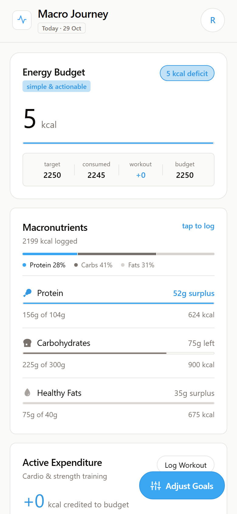
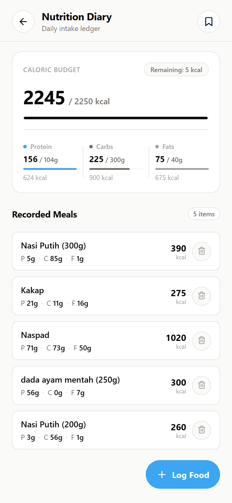
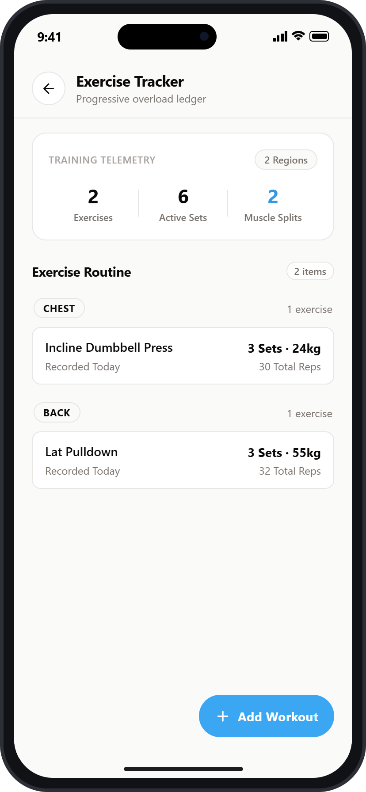
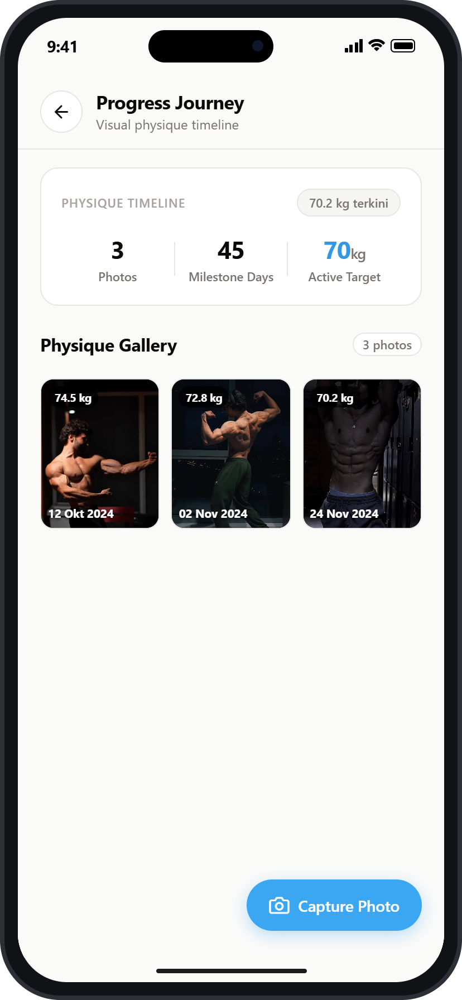
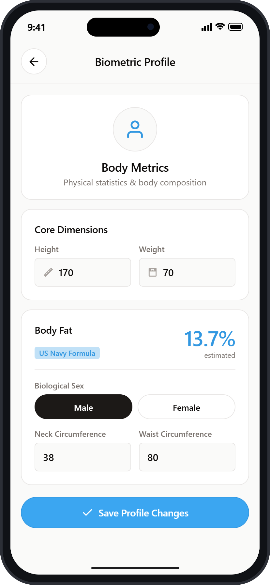
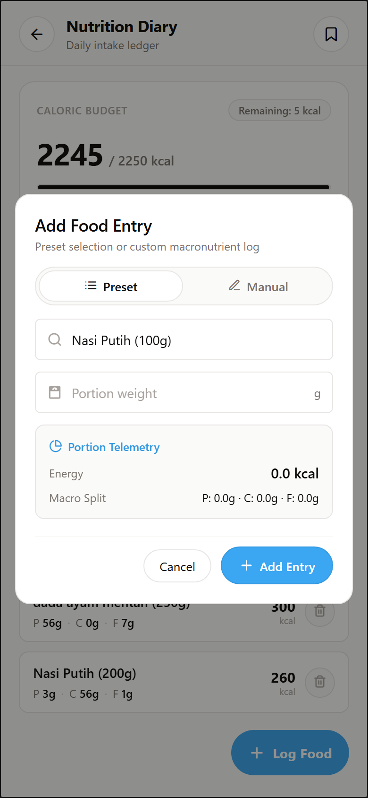

# Macro Journey

Aplikasi pelacak nutrisi, target kalori harian (makronutrien), dan progres latihan fisik.

---

## Tampilan Layar

| Dashboard | Diary Makanan | Latihan Fisik |
| :---: | :---: | :---: |
|  |  |  |

| Kamera & Foto | Profil & Target | Tambah Makanan |
| :---: | :---: | :---: |
|  |  |  |

---

## Daftar Layar

- **Dashboard**: Ringkasan kalori harian, progress bar nutrisi (karbohidrat, protein, lemak), serta sisa kuota kalori harian.
- **Diary Makanan**: Riwayat konsumsi makanan harian .
- **Latihan Fisik (Exercise)**: Pencatatan sesi workout per otot , lengkap dengan histori set, repetisi, dan beban.
- **Halaman Progress**:  penyimpanan foto progress user.
- **Profil & Target (Goals)**: Pengaturan metrik tubuh (berat, tinggi, dan lingkar badan).

---

## Cara Menjalankan

1. Unduh paket dependensi:
   ```bash
   npm install
   ```

2. Jalankan project :
   - **Browser (Web)**:
     ```bash
     npm run web
     ```
   - **Perangkat Android**:
     ```bash
     npm run android
     ```
   - **Perangkat iOS**:
     ```bash
     npm run ios
     ```
   - **Expo Development Server**:
     ```bash
     npm start
     ```
